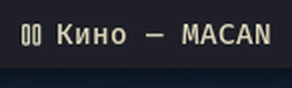
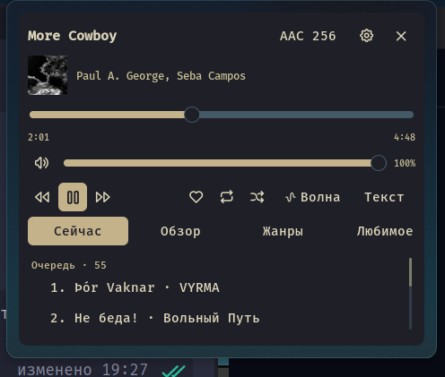

# ymd

[](https://github.com/pbolkhovitin/ymd/actions/workflows/ci.yml)
[](https://github.com/pbolkhovitin/ymd/releases)
[](LICENSE)

Клиент **Яндекс Музыки** для **KDE Plasma 6** и **Noctalia** (niri): плазмоид
в панели, отдельное приложение на Qt/Kirigami, плагин для бара Noctalia и
Rust-демон `ymd`. Без Electron, без анимаций по умолчанию, с нативным PipeWire
и MPRIS.

> **Неофициальный клиент.** Проект не связан с ООО «Яндекс» и не поддерживается
> им. «Яндекс Музыка» — товарный знак правообладателя; название используется
> только для обозначения совместимости. Пользуйтесь подпиской, которую оплатили.
> Правовая политика проекта — `LEGAL.md`, сторонние компоненты и товарные
> знаки — `NOTICE`.

## Из чего состоит

| Часть | Что делает | Технология |
|---|---|---|
| `ymd` | токен, API Яндекса, GStreamer-плеер, MPRIS, офлайн-кэш, «Моя волна» | Rust, systemd --user |
| `plasma-widget-ymd` | компактный виджет в панели и попап: поиск, очередь, транспорт, режимы | QML / Plasma 6 |
| `ymd-qt` | отдельное окно + трей: те же поиск, очередь, транспорт, режимы | Qt 6 / Kirigami |
| `yandex-music` (Noctalia) | бар-виджет (подпись «ymd» или трек) и панель: поиск, очередь, транспорт, перемотка, громкость | Luau, plugin_api 35 |

Плазмоид, `ymd-qt` и плагин Noctalia не знают токен и не обращаются к API
Яндекса. Они общаются только с локальным HTTP API `127.0.0.1:8765`; ключ
доступа — `$XDG_RUNTIME_DIR/ymd/session.key` (0600), клиенты получают его
командой `ymd session-key` или чтением файла.

Демон экспортирует MPRIS `org.mpris.MediaPlayer2.ymd`, поэтому медиа-клавиши и
встроенный виджет `media` Plasma работают без нашего плазмоида.

## Скриншоты

Снято на реальном хосте: Fedora 44, niri 26.04, Noctalia v5.4.1, тема Dracula,
аккаунт с подпиской (поток FLAC).

**Бар** — значок действия (пауза, пока играет), трек и артист:



**Панель** — качество потока, обложка, перемотка, транспорт, режимы
(`♥`, повтор, перемешивание, «Волна», «Текст»), вкладки и очередь:



Скриншоты плазмоида и `ymd-qt` появятся с KDE-хоста: здесь запущен niri, эти
клиенты на данной машине не собирались и не запускались.

Social preview для GitHub — `docs/images/social-preview.png` (1280×640),
пересобирается `bash scripts/social-preview.sh`.

## Установка из .deb

Пакеты собираются в `dist/`:

```bash
bash packaging/build-deb.sh --arch arm64      # демон и плазмоид
bash packaging/build-qt-deb.sh --arch arm64   # отдельное приложение

ver=$(bash scripts/version.sh)
sudo apt install ./ymd_${ver}_arm64.deb ./plasma-widget-ymd_${ver}_all.deb \
                 ./ymd-qt_${ver}_arm64.deb
systemctl --user daemon-reload
systemctl --user enable --now ymd
```

После установки добавьте виджет «ymd» на панель: правый клик по панели →
«Добавить виджеты» → «ymd». Отдельное приложение запускается из меню или
командой `ymd-qt`.

## Установка из .rpm (Fedora)

Те же три пакета собираются в Fedora-контейнере (`rpmbuild`):

```bash
bash packaging/build-rpm.sh                  # amd64: демон, плазмоид, ymd-qt
bash packaging/build-rpm.sh --arch arm64     # arm64
bash packaging/build-rpm.sh --no-qt          # без ymd-qt, быстрее

ver=$(bash scripts/version.sh)
sudo dnf install ./ymd-${ver}-1.fc44.*.rpm \
                 ./plasma-widget-ymd-${ver}-1.fc44.noarch.rpm \
                 ./ymd-qt-${ver}-1.fc44.*.rpm
systemctl --user daemon-reload
systemctl --user enable --now ymd
```

Зависимости проставлены по именам Fedora (`gstreamer1`, `libsecret`,
`playerctl`), библиотечные зависимости RPM вычисляет сам. Юнит ставится в
`/usr/lib/systemd/user/ymd.service`, поэтому запускается от пользователя,
а не от root.

## Сборка для macOS (Apple Silicon)

Демон собирается под arm64 обычным `cargo`; плазмоид и плагин Noctalia —
Linux-only, а `ymd-qt` на macOS ждёт отдельной работы (трей через D-Bus).

```bash
brew install pkgconf gstreamer gst-plugins-base gst-plugins-good
bash packaging/macos/build.sh       # ставит зависимости и собирает release
./target/release/ymd auth login
./target/release/ymd serve
```

Самостоятельное приложение для строки меню (SwiftUI), целевая система —
macOS 13 Ventura+ на Apple Silicon: перенесите `.app` из DMG в «Программы»,
откройте, войдите через Яндекс и включите «Мою волну». Демон, аудиоплагины
и библиотеки включены в `.app`; Homebrew и терминал для запуска не нужны.
Сборка проверена на macOS 27.2.1, минимальные версии всех вложенных Mach-O
проверяются на совместимость с 13.0; запуск на самой Ventura ещё не проверен.

Сборка приложения из исходников (Xcode CLT, Rust, Python 3, `pkg-config`):

```bash
LC_ALL=C bash macos/build.sh --install
open ~/Applications/ymd-menubar.app
bash macos/build-dmg.sh                    # dist/ymd-menubar-<версия>.dmg
```

Готовые сборки: `.deb`/`.rpm` — в релизах; DMG собирается на Mac
(`hdiutil`), в релиз прикладывается вручную или через `macos-release.yml`.
Официальный runtime GStreamer 1.28.8 скачивается в кэш сборки с проверкой
SHA-256; глобально framework не устанавливается.

Подробности, LaunchAgent и ограничения — `docs/14-macos.md`;
бриф для работы над macOS-частью — `docs/15-macos-brief.md`.

## Установка плагина Noctalia

Плагин живёт в `noctalia/` и подключается симлинком (Noctalia перезаписывает
собственные копии при обновлении, поэтому источник — репозиторий):

```bash
bash scripts/install-noctalia.sh          # симлинк + reload, если Noctalia запущена
noctalia msg plugins list                 # должен появиться pbolkhovitin/yandex-music
```

Виджет добавляется в бар через настройки Noctalia (`Bar` → `widgets`), панель
открывается правым кликом по виджету. Нужен Noctalia 5.x и `plugin_api >= 35`.

## Релизы и версии

Готовые пакеты и заметки — в [Releases](https://github.com/pbolkhovitin/ymd/releases).
Релиз ставится тегом `vX.Y.Z` из `main`; CI собирает `.deb` и `.rpm` демона,
плазмоида и `ymd-qt`, архив плагина Noctalia и создаёт GitHub Release.

Одна версия на весь проект, источник истины — `Cargo.toml`:

```bash
bash scripts/version.sh            # текущая версия
bash scripts/version.sh --check    # манифесты совпадают
ymd --version                      # версия запущенного демона
```

Порядок выпуска, правила SemVer и changelog — `docs/13-versioning.md`,
история изменений — `CHANGELOG.md`.

## Быстрый старт для разработки

```bash
# тесты демона в контейнере (на хосте Rust может отсутствовать)
bash packaging/run-tests.sh

# запуск демона
cargo run -p ymd -- serve

# проверка
ymd doctor
ymd status --json
curl -s http://127.0.0.1:8765/v1/health

# плазмоид: установка/обновление в текущую сессию
bash scripts/dev-install.sh

# отдельное приложение: сборка .deb и запуск из build-кэша
bash packaging/build-qt-deb.sh --arch amd64
```

Для входа: `ymd auth login` (OAuth Device Flow) или
`ymd auth import --from-official`.

## CLI

| Команда | Смысл |
|---|---|
| `ymd serve [--port]` | запустить демон |
| `ymd session-key` | напечатать capability-ключ для плазмоида |
| `ymd status [--json]` | состояние плеера |
| `ymd ctl toggle\|play\|pause\|next\|prev\|like\|mode` | управление |
| `ymd search "…" [--json]` | поиск |
| `ymd wave [--json]` | включить «Мою волну» |
| `ymd quality [lossless\|hq\|nq\|lq]` | качество звука |
| `ymd download <id>` / `download-album <id>` | офлайн-кэш |
| `ymd cache list\|path\|remove\|info` | управление кэшем |
| `ymd lyrics <id> [--text]` | текст песни (LRC или чистый) |
| `ymd track <id>` / `stream <id>` | метаданные и URL потока |
| `ymd auth login\|import\|status\|logout` | авторизация |
| `ymd doctor` | проверка окружения |
| `ymd logs [-n N] [-f] [--path]` | хвост файла логов |

## Логи

Демон пишет в journald и в файл `~/.local/state/ymd/ymd.log` (ротация на
5 МиБ). Уровень — `YMD_LOG` (по умолчанию `info`, для разбора очереди удобно
`YMD_LOG=debug`).

```bash
ymd logs -n 50      # последние 50 строк
ymd logs -f         # следить
```

Разбор «зациклило один трек»: сравните `track=` в строках `eos -> next`,
`queue step` и `stream resolved` — они должны совпадать.

## Статус

| Что | Состояние |
|---|---|
| Демон: API, поток, GStreamer, MPRIS | ✅ |
| Офлайн-кэш: download, LRU, локальное воспроизведение | ✅ |
| «Моя волна»: запуск, автодогрузка, feedback | ✅ |
| Открытие: главная, жанры/настроения, подборки, плейлисты, избранное, радио | ✅ демон и Noctalia |
| Плазмоид: компакт, попап, поиск, очередь, режимы | ✅ |
| Отдельное приложение Qt/Kirigami: окно + трей | ✅ |
| Пакеты `.deb` и `.rpm` (amd64/arm64) | ✅ |
| Тексты песен | ✅ демон, CLI, панель Noctalia |
| Докачка после обрыва: `.part` + `Range`, проверка ключа | ✅ |
| Ynison | не сделана |

## Документация

| Файл | О чём |
|---|---|
| `docs/01-concept.md` | продукт, принципы, сценарии |
| `docs/02-architecture.md` | компоненты и IPC-контракт |
| `docs/03-kde-plasmoid.md` | пакет Plasma, ключ, polling, виджет и попап |
| `docs/04-daemon.md` | модули демона, CLI, MPRIS, кэш, волна, качество |
| `docs/05-feature-matrix.md` | паритет с официальным клиентом |
| `docs/design/ui-rules.md` | общие правила UI: состояния, обрезка, акценты, анимации |
| `docs/design/plasma.md` | дизайн плазмоида: Kirigami, цвета, запрет анимаций |
| `docs/design/noctalia.md` | плагин Noctalia: бар, панель, `ui.*`, ограничения хоста |
| `docs/design/noctalia-design.md` | дизайн-язык панели Noctalia и замеры |
| `docs/07-roadmap.md` | этапы и следующий шаг |
| `docs/08-risks.md` | риски и открытые вопросы |
| `docs/09-p0-spikes.md` | проверки окружения и история спайков |
| `docs/10-oauth-registration.md` | регистрация OAuth-приложения в Яндекс ID (историческая разведка) |
| `docs/11-qt-app.md` | приложение `ymd-qt`: архитектура, сборка, трей, ограничения |
| `docs/12-discovery-account.md` | главная, жанры/настроения, плейлисты, избранное, вход и настройки: анализ и план |
| `notes/kde-port-findings.md` | факты порта: хост, QML, упаковка |
| `notes/noctalia-ui-findings.md` | грабли Yoga/Luau в панели Noctalia |
| `notes/m1-findings.md` … `m4-findings.md` | факты по этапам: поток, очередь, кэш, волна |
| `notes/lyrics-findings.md` | подпись и формат текстов песен (разведка) |
| `LEGAL.md` | правовая политика: товарные знаки, совместимость, порядок при претензии |
| `NOTICE` | товарные знаки и лицензии сторонних компонентов |

## Требования

- KDE Plasma 6 (проверено на 6.6.6, Wayland) — для плазмоида и `ymd-qt`.
- Noctalia 5.x на niri (Wayland, `plugin_api >= 35`) — для плагина `noctalia/`.
- PipeWire + WirePlumber; GStreamer 1.24+ с плагинами good/bad/libav.
- `playerctl`, `libsecret-tools`, `dbus-user-session`.
- Для сборки: Docker с binfmt для arm64 (демон — Rust + GStreamer dev,
  приложение — Qt 6 + Kirigami dev; всё уже в `packaging/Dockerfile*`).

## Участие в разработке

Подпись коммитов, ветки, правило «один PR — один клиент» и проверки CI —
`CONTRIBUTING.md`. Коротко: свой `user.email` в git, ветка от свежего `main`,
заголовок PR в стиле Conventional Commits, squash-merge,
`scripts/docs-check.sh` и `scripts/pr-check.sh` перед PR.

## Связанные материалы

Реверс-инжиниринг официального клиента: `~/github/yandex-music-research` —
API, подписи, `encraw`, крейты `ym-api`/`ym-auth`/`ym-media`.
