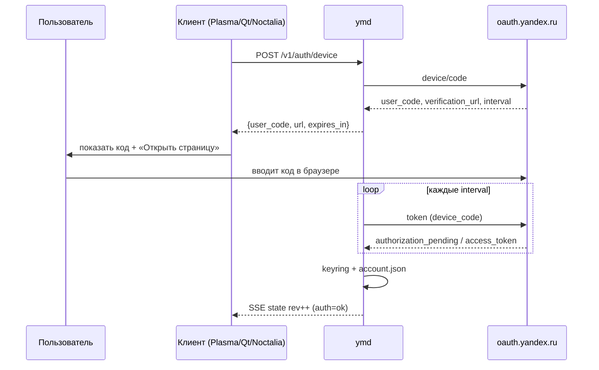

# 12. Открытие музыки, плейлисты, избранное и вход

Анализ, принятые решения и фактический статус реализации. Даём разведку живого
API, модель демона и то, что уже сделано в коде: этапы 1–4 (демон) и 6 (панель
Noctalia) реализованы, этапы 5 и 7 (интерфейсы Plasma и `ymd-qt`) — в работе.

Проверки выполнены 2026-11-14 на аккаунте `pbolkhovitin` (uid 12967407, Plus),
демон `ymd 0.2.0`, токен из keyring. Все ответы — `200`, если не указано иное.

## Что уже проверено

| Запрос | Результат |
|---|---|
| `GET /landing3?blocks=personalplaylists,promotions,new-releases,new-playlists,mixes,chart,artists,albums,playlists,play_contexts` | 7 блоков: «Собираем для вас» (4), «Вы недавно слушали» (8), «Интересно сейчас» (2), «Новые релизы» (4), «Популярные плейлисты» (4), «Чарт» (10), `mixes` пустой |
| `GET /landing3/metatags` | 4 дерева: Настроения (17), Занятия (11), Жанры (24), Эпохи (9); листья `{tag, title, leaves[]}`, без id |
| `GET /metatags/{tag}/playlists` | `result.stationId` = `mood:calm`, `id`, `title`, 25 плейлистов — точка входа и в плейлисты, и в радио |
| `GET /genres` | 36 жанров: `id` (`pop`, `allrock`, `indie`, …), `title`, `images`, `subGenres`, `radioIcon` |
| `GET /rotor/station/genre:rock/info` | 200, станция `{type: genre, tag: rock}`, имя, иконка |
| `GET /rotor/station/artist:41075/info` | 200, станция «КИНО» — волна по артисту |
| `GET /rotor/stations/dashboard` | 4 личные станции, включая «Моя волна» (`user:onyourwave`) |
| `GET /users/{uid}/playlists/3` | «Мне нравится», 52 трека, kind = 3 |
| `GET /users/{uid}/likes/tracks` | 200, список лайкнутых треков |

Из `~/github/yandex-music-research/docs/06-api.md` (проверено там, у нас — нет):
`POST /users/{uid}/likes/tracks/add|remove`, `POST /users/{uid}/playlists/create`,
`POST /users/{uid}/playlists/{kind}`, `/users/{uid}/likes/{albums,artists}/page`.

## 1. Открытие: главная, жанры, настроения, артист

Источник — только официальный API, без парсинга HTML. Три уровня:

1. **Главная** — `/landing3` с фиксированным списком блоков. Не «бесконечная
   лента»: 6–7 блоков достаточно, порядок стабильный.
2. **Каталог** — `/landing3/metatags` (Настроения, Занятия, Жанры, Эпохи) и
   `/genres` (жанры с поджанрами и иконками). Клик по тегу → `/metatags/{tag}`
   → плейлисты + `stationId`.
3. **Радио** — rotor-станция из тега (`genre:rock`, `mood:calm`) или артиста
   (`artist:{id}`). Уже есть `wave_*` в демоне — расширяем его на произвольную
   станцию, а не пишем второй плеер.

### Модель в демоне

Нормализуем ответы до плоских структур — клиенты не должны знать про
`landing3` и вложенность `blocks[].entities[]`:

```json
{ "id": "new-releases", "title": "Новые релизы", "type": "album",
  "items": [{ "id": "123", "kind": "album", "title": "…", "subtitle": "…",
              "cover": "https://…", "trackCount": 12 }] }
```

Правила:

- `id` блока — из API, не позиция: порядок может меняться.
- Обложки отдаём URL (Plasma/Qt грузят сами), в Noctalia — существующий путь
  через `pluginDataDir()`.
- Неизвестный тип сущности не выбрасывает блок: элемент пропускается, блок
  остаётся с тем, что распознали.
- Кэш: главная — 10 минут, дерево метатегов — сутки, страница тега — 10 минут.
  Кэш в памяти демона, без диска.

### Что показывать в клиентах

| Клиент | Главная | Каталог | Артист |
|---|---|---|---|
| Plasma-попап | 3 блока по 4–6 карточек, горизонтальные ряды | чипы «Настроения / Жанры» → список тегов → страница тега | кнопка «Волна по артисту» в строке трека и на странице артиста |
| `ymd-qt` | те же блоки, сетка, больше элементов | боковая навигация: Обзор / Жанры / Настроения / Избранное | страница артиста: топ-треки + волна |
| Noctalia-панель | 2 блока списком (компактно, без карусели) | «Жанры» → тег → «Играть волну» + первые 5 плейлистов | «Волна по артисту» из очереди/поиска |

Ограничения вёрстки: никаких вложенных вертикальных скроллов (попап Plasma
уже ограничен `gridUnit*38`); горизонтальные ряды — одним `ListView` с
`orientation: ListView.Horizontal`. В Noctalia — только вертикальный список в
единственном `ui.scroll`.

## 2. Плейлисты

Уже работает: список (`/v1/playlists`), детали (`/v1/playlist`), проигрывание,
а также создание, удаление, правка и добавление треков в демоне
(`playlist_create`, `playlist_delete`, `playlist_change`, `playlist_add_tracks`)
и в `ymd-qt` (меню трека, диалог).

Не хватает:

- **Плазмоид и Noctalia**: кнопки «Добавить в плейлист» и «Создать плейлист».
  В Noctalia-панели создание не начинать — нет клавиатуры; только добавление
  текущего трека в существующий.
- **Свои vs чужие**: `uid` берётся из `Account`; кнопка «Изменить» видна только
  для `playlist.owner.uid == account.uid`.
- **Проверка `playlist_change`**: diff-формат (`{"diff": …}`) нужно покрыть
  тестом на реальном плейлисте, иначе правка тихо не применяется.

## 3. Избранное

Факт: «Мне нравится» — обычный плейлист `kind = 3`, 52 трека. Отдельного
хранилища нет, поэтому:

- экран «Избранное» = `GET /v1/playlist?kind=3` (плюс пагинация, если треков
  станет много);
- лайк трека = `POST /users/{uid}/likes/tracks/add-multiple|remove`
  (`api::like_track`), состояние в `/v1/state` уже есть (`track.liked`);
- **дефект клиентов (исправлен)**: `ymd-qt` вызывает `like_track` правильно;
  плазмоид и Noctalia-панель раньше слали старую команду `like`, которая только
  переключала локальный флаг. Теперь все три клиента ходят в API.

Порядок в UI: оптимистичное переключение иконки → запрос → при ошибке откат и
короткий текст ошибки. Дизлайки и лайки артистов/альбомов — после треков.

## 4. Вход: где вводить данные

### Проблема

- Панель Noctalia **не забирает фокус клавиатуры** (проверено): ввести токен
  или код внутри панели нельзя.
- Вставлять 60-символьный токен в попап Plasma — плохой сценарий, даже если
  технически возможно.
- Сейчас вход есть только в CLI (`ymd auth login`, Device Flow): код и URL
  печатаются в терминал, браузер не открывается, `refresh_token` не
  сохраняется.

### Решение (рекомендация): Device Flow принадлежит демону

Клиенты не вводят секреты — они показывают код и открывают страницу.



Почему так:

- код короткий — его видно в панели, а ввод происходит в браузере, где
  клавиатура работает;
- токен никогда не проходит через клиент и не попадает в QML/Luau;
- один механизм для всех трёх клиентов и для CLI.

Эндпоинты (все под `X-YMD-Session`, только loopback):

| Метод | Путь | Смысл |
|---|---|---|
| POST | `/v1/auth/device` | начать вход; 409, если уже идёт |
| GET | `/v1/auth/device` | `{state: pending\|authorized\|expired\|error, user_code, url, expires_in}` |
| DELETE | `/v1/auth/device` | отменить ожидание |
| GET | `/v1/account` | `{login, uid, plus, backend, expires_at}` или 401 |
| POST | `/v1/auth/logout` | удалить токен из keyring и состояние |

Дополнительно в CLI: `ymd auth login --open` (запустить браузер через
`xdg-open`), `ymd auth token --stdin` для импорта без эха в истории,
`--no-wait` уже есть.

### Что видит пользователь

- **Нет токена**: Plasma — компакт показывает `!` и tooltip «Требуется вход»,
  попап — экран с кодом, кнопками «Открыть страницу», «Копировать код»,
  «Отмена». `ymd-qt` — то же в диалоге. Noctalia — секция в панели: код,
  «Открыть страницу», «Обновить»; копирование — если хост даст API буфера
  (сейчас неизвестно, не обещать).
- **Токен отклонён (401)**: тот же экран + «Войти заново», старые данные не
  стираем, но помечаем устаревшими.
- **Нет Plus**: бейдж в аккаунте, качество `lossless` не предлагать по
  умолчанию (фоллбэк уже есть).
- **Выход**: пункт в настройках аккаунта, подтверждение, очистка keyring.

Безопасность: код и токен не логировать; device flow — не больше одной сессии;
`/v1/auth/logout` не принимает токен в теле; `refresh_token` хранить в том же
keyring-элементе и обновлять по 401 (сейчас теряется, срок токена ~год).

## 5. Настройки приложения

Сейчас: `~/.config/ymd/config.toml` (`playback.quality`, `playback.fallback_hq`,
`cache.limit_mb`) + порт демона в конфиге плазмоида. Настроек в Noctalia нет,
UI для качества/кэша есть только частично.

Рекомендация: **единственный владелец настроек — демон**, клиенты рисуют
контролы поверх API:

| Настройка | Владелец | Где показывать |
|---|---|---|
| качество, фоллбэк | `config.toml` | Plasma-попап (циклер), Qt-настройки, Noctalia-панель |
| лимит кэша | `config.toml` | Qt-настройки, Plasma-конфиг |
| порт демона | конфиг клиента | только Plasma-конфиг (локальная привязка) |
| «показывать артиста в баре» | клиент | настройка виджета Noctalia (схема не проверена) |

Эндпоинты: `GET /v1/config` (эффективные значения + путь файла),
`PATCH /v1/config` (белый список полей, запись атомарная, hot-apply без
перезапуска). Клиенты не пишут `config.toml` сами.

Что не делать: не дублировать качество в трёх местах, не хранить настройки
демона в QSettings/настройках плагина.

## 6. Состояния и ошибки

| Состояние | Признак | Поведение |
|---|---|---|
| нет токена | `/v1/account` → 401, `/v1/playlists` → «нет аккаунта» | экран входа, поиск/главная скрыты |
| токен отклонён | API → 401 после перечитки | «Войти заново», данные помечены устаревшими |
| нет Plus | `account.plus = false` | бейдж, качество не выше `hq` по умолчанию |
| офлайн | ошибка сети | кэш + пометка, кнопка «Повторить» |
| rate limit | 429 | экспоненциальный повтор, без спама |

Пустые состояния: «Ничего не найдено», «Плейлист пуст», «Избранное пусто».
Ошибки — текстом, не только цветом (`docs/design/ui-rules.md`).

## 7. План работ

| Этап | Что | Размер |
|---|---|---|
| 1 | демон: `landing`, `metatags`, `genres`, `tag`, радио по станции; кэш в памяти | M |
| 2 | демон: `/v1/home`, `/v1/discovery/*`, `/v1/radio`; нормализация блоков | S–M |
| 3 | клиенты: перевести Plasma и Noctalia с `like` на `like_track`; `/v1/favorites` | S |
| 4 | демон: `/v1/auth/*`, `/v1/account`, `/v1/config`; `ymd auth login --open` | S–M |
| 5 | Plasma: главная + каталог + экран входа + настройки | M |
| 6 | Noctalia: секции «Главная / Жанры / Избранное», статус входа | M |
| 7 | `ymd-qt`: боковая навигация, страница артиста, диалог входа | M |

Порядок обязателен: сначала API и `like`, потом UI. Этапы 1–4 не меняют
внешний вид — их можно делать параллельно с правками Леонида, не конфликтуя
файлами.

Состояние: этапы 1–4 и 6 сделаны (эндпоинты в `docs/02-architecture.md`,
клиенты Plasma и Noctalia переведены на `like_track`, панель Noctalia получила
«Сейчас / Обзор / Жанры / Любимое», вход и настройки). Дополнительно добавлен
`/v1/album` для карточки альбома. Этапы 5 и 7 — интерфейсы Plasma и `ymd-qt`
(их ведёт Леонид).

## 8. Риски и открытые вопросы

- **Теги локализованы**: `tag`/`title` в `/landing3/metatags` — отображаемые
  строки; стабильного id у листа нет. Кэш и запросы ключуем по строке тега
  (URL-encoded), для жанров используем `id` из `/genres`. Проверить, не
  меняется ли `tag` при смене языка аккаунта.
- **`mixes` в `landing3` пустой** — блок зависит от аккаунта/региона; клиент
  должен переживать отсутствие любого блока.
- **`playlist_change` (diff)** реализован в демоне, но не проверен на живом
  плейлисте; `likes/tracks/add-multiple` с `track-ids` уже используется
  демоном и подтверждён кодом, но не тестом.
- **Noctalia**: API буфера обмена и схема настроек виджета не подтверждены;
  до проверки не обещать копирование кода и переключатели.
- **Высота попапа Plasma** ограничена; главная — только горизонтальные ряды,
  иначе список уйдёт под обрез.
- **Refresh-токен** сейчас не сохраняется; если API начнёт отзывать access
  token раньше года — вход будет требовать ручного повтора.

## Решения

- D1. Открытие — `/landing3` + `/landing3/metatags` + `/genres`; без парсинга.
- D2. Радио по жанру/настроению/артисту — rotor-станции, один код с «Моей
  волной».
- D3. Избранное — плейлист `kind = 3`; лайк обязан ходить в API.
- D4. Вход — Device Flow в демоне, `/v1/auth/*`; клиенты показывают код и
  открывают браузер, токен в клиенты не попадает.
- D5. Настройки — `config.toml` как единственный источник, `/v1/config`.
- D6. Паритет поверхностей по `docs/design/ui-rules.md`: одинаковый набор
  блоков, различия — только оформление и явно отсутствующие блоки.
